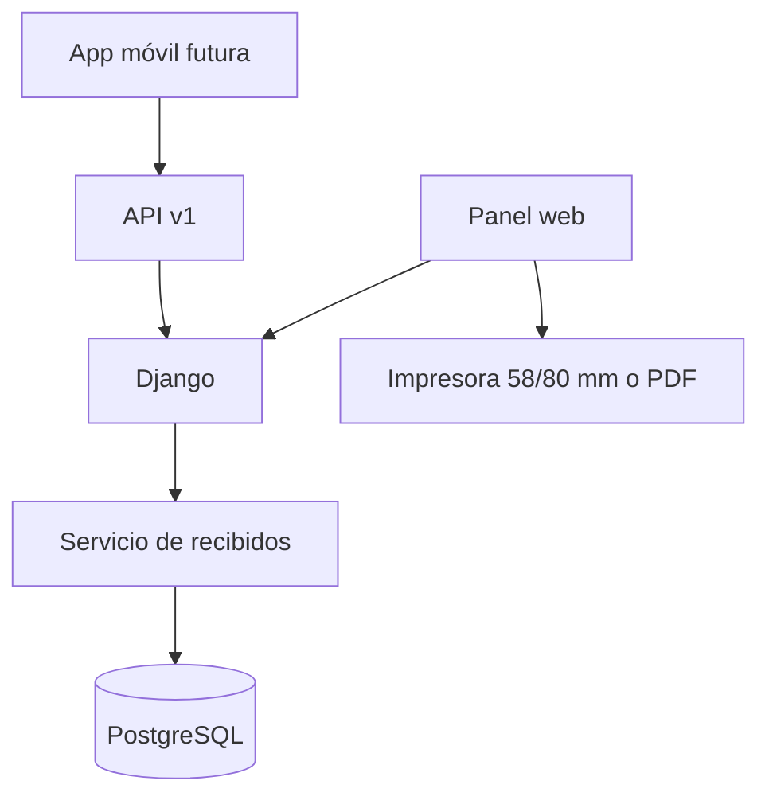
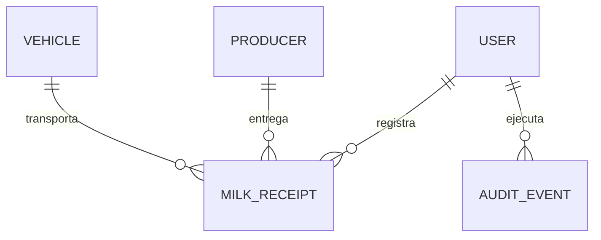

# Arquitectura del MVP web UBALAC

## Enfoque

Se implementa un monolito modular Django con web renderizada en servidor y API REST versionada. Web y móvil comparten la misma validación, numeración y auditoría.



## Componentes

| Módulo | Responsabilidad |
|---|---|
| `accounts` | Usuarios, roles, autenticación y políticas del navegador |
| `operations` | Productores, rutas, vehículos, recorridos, recibidos, comprobantes y configuración de conductores |
| `dashboard` | Indicadores de recolección |
| `auditlog` | Bitácora de acciones sensibles |
| `api` | Contrato `/api/v1` para sincronización móvil |
| `config` | Configuración local/producción y rutas |



## Reglas implementadas

La parametrización móvil reside en `DriverProfile` (relación uno a uno con el usuario, rutas y productores; las placas se asignan en `Vehicle.driver`). La clave adicional del módulo se guarda como hash en `DriverModuleSecurity` y se valida antes de acceder a las pantallas de gestión. La contraseña del conductor también tiene un hash para autenticación y, desde v0.5.2, una copia cifrada para la consulta en la ficha protegida; las anteriores requieren restablecimiento. El endpoint propio del conductor no entrega contraseñas ni permite escribir la configuración. Consulte `docs/DRIVERS_MOBILE_CONFIGURATION.md` para el flujo actualizado.

- Los litros deben ser mayores que cero.
- Productor y vehículo deben estar activos al crear el recibido.
- Cada recibido obtiene un UUID y consecutivo anual `REC-AAAA-######`.
- El comprobante usa exactamente los datos persistidos en el recibido; no mantiene una copia divergente.
- Un `external_id` reenviado desde móvil devuelve el registro existente en lugar de duplicarlo.
- Los recibidos se anulan con motivo y actor; no se eliminan.
- Un comprobante anulado se imprime con marca visible `ANULADO`.

## Flujo operativo

1. El recolector selecciona proveedor y vehículo.
2. Registra fecha, litros y observaciones.
3. El servidor valida, asigna consecutivo y guarda auditoría.
4. Se abre el comprobante para tirilla de 58/80 mm o PDF.
5. Se entrega la copia al proveedor y el registro queda consultable.
6. Cuando exista la app móvil, el mismo `external_id` permitirá sincronizar sin duplicar.

## Estructura

```text
ubalac_web/
├── apps/accounts/
├── apps/api/v1/
├── apps/auditlog/
├── apps/dashboard/
├── apps/operations/
│   ├── services/
│   └── tests/
├── config/settings/
├── docs/
├── static/css/
├── static/js/
└── templates/operations/
```

## Preparación para móvil

La futura app deberá guardar localmente un UUID antes de la captura, trabajar con cola offline cifrada y enviar el recibido cuando recupere conexión. El servidor conserva la autoridad sobre el consecutivo y devuelve la estructura del comprobante para impresión Bluetooth de 58/80 mm.
